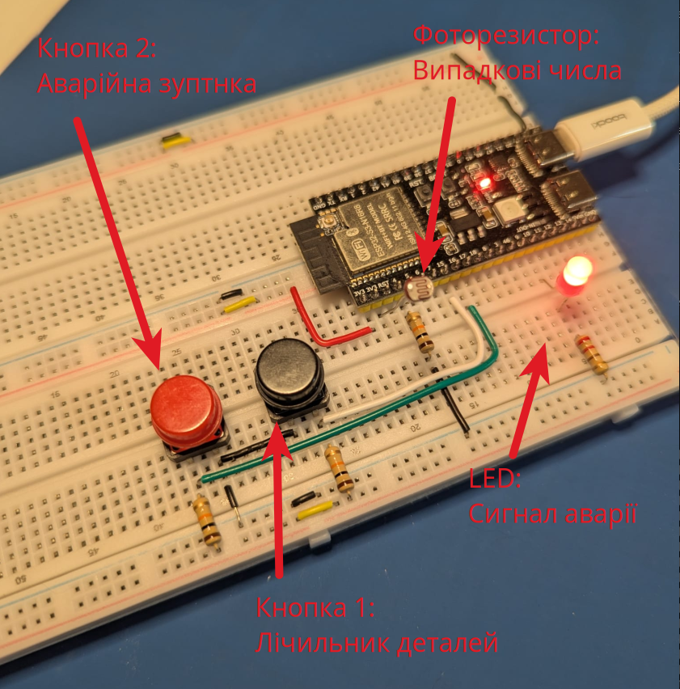

# Урок 6.5 - Багатоядерність, ISR, спільні ресурси
Source: https://github.com/ValeriiaOmelchenko/emb_28/blob/main/6.5/Task.md

## Завдання

**Апаратна частина:** ESP32-S3 DevKit; кнопка 1 (імітує оптичний датчик - лічить деталі);
кнопка 2 або BOOT (аварійна зупинка); світлодіод (індикатор тривоги); вільний пін АЦП
(або реальний датчик, наприклад температури).

**Логіка роботи:**
1. **Глобальний лічильник деталей.** Кнопка 1 викликає ISR, у якому глобальний лічильник
   збільшується на +1. Лічильник читають інші задачі.
2. **Системний звіт.** Є один глобальний масив-рядок для звіту.
   - Task 1 (Core 0): раз на секунду читає лічильник, рахує швидкість конвеєра (деталі/хв)
     і форматує дані у спільний буфер звіту.
   - Task 2 (Core 1): раз на секунду читає АЦП і дописує у той самий буфер.
3. **Аварійна зупинка.** Кнопка 2 викликає ISR. Task 3 має найвищий пріоритет і в нормальному
   стані «спить», не споживаючи CPU. При натисканні кнопки 2 Task 3 миттєво прокидається,
   вмикає LED, безпечно записує у буфер `SYSTEM HALTED!` і блокує подальшу роботу конвеєра.

---

## Виконання


### Вивід serial monitor.
```
I (282) CONVEYOR: Conveyor system started! Press BTN1 to count parts, BTN2 for Emergency Stop.
I (1782) CONVEYOR: [Core 0] Parts: 0 | Speed: 0 parts/min || [Core 1] ADC Raw: 1419
I (2782) CONVEYOR: [Core 0] Parts: 0 | Speed: 0 parts/min || [Core 1] ADC Raw: 1417
I (3782) CONVEYOR: [Core 0] Parts: 0 | Speed: 0 parts/min || [Core 1] ADC Raw: 1419
I (4782) CONVEYOR: [Core 0] Parts: 0 | Speed: 0 parts/min || [Core 1] ADC Raw: 1421
I (5782) CONVEYOR: [Core 0] Parts: 1 | Speed: 60 parts/min || [Core 1] ADC Raw: 1427
I (6782) CONVEYOR: [Core 0] Parts: 5 | Speed: 240 parts/min || [Core 1] ADC Raw: 1435
I (7782) CONVEYOR: [Core 0] Parts: 7 | Speed: 120 parts/min || [Core 1] ADC Raw: 228
I (8782) CONVEYOR: [Core 0] Parts: 10 | Speed: 180 parts/min || [Core 1] ADC Raw: 135
I (9782) CONVEYOR: [Core 0] Parts: 13 | Speed: 180 parts/min || [Core 1] ADC Raw: 1178
I (10782) CONVEYOR: [Core 0] Parts: 16 | Speed: 180 parts/min || [Core 1] ADC Raw: 1385
I (11782) CONVEYOR: [Core 0] Parts: 20 | Speed: 240 parts/min || [Core 1] ADC Raw: 1381
I (12782) CONVEYOR: [Core 0] Parts: 23 | Speed: 180 parts/min || [Core 1] ADC Raw: 1444
I (13782) CONVEYOR: [Core 0] Parts: 26 | Speed: 180 parts/min || [Core 1] ADC Raw: 1443
I (14782) CONVEYOR: [Core 0] Parts: 29 | Speed: 180 parts/min || [Core 1] ADC Raw: 1369
I (15782) CONVEYOR: [Core 0] Parts: 34 | Speed: 300 parts/min || [Core 1] ADC Raw: 1381
I (16782) CONVEYOR: [Core 0] Parts: 39 | Speed: 300 parts/min || [Core 1] ADC Raw: 1371
I (17782) CONVEYOR: [Core 0] Parts: 43 | Speed: 240 parts/min || [Core 1] ADC Raw: 250
I (18782) CONVEYOR: [Core 0] Parts: 47 | Speed: 240 parts/min || [Core 1] ADC Raw: 1434
I (19782) CONVEYOR: [Core 0] Parts: 51 | Speed: 240 parts/min || [Core 1] ADC Raw: 1420
I (20782) CONVEYOR: [Core 0] Parts: 53 | Speed: 120 parts/min || [Core 1] ADC Raw: 1423
I (21782) CONVEYOR: [Core 0] Parts: 55 | Speed: 120 parts/min || [Core 1] ADC Raw: 1421
I (22782) CONVEYOR: [Core 0] Parts: 55 | Speed: 0 parts/min || [Core 1] ADC Raw: 1419
I (23782) CONVEYOR: [Core 0] Parts: 55 | Speed: 0 parts/min || [Core 1] ADC Raw: 1417
I (24782) CONVEYOR: [Core 0] Parts: 56 | Speed: 60 parts/min || [Core 1] ADC Raw: 1419
I (25782) CONVEYOR: [Core 0] Parts: 60 | Speed: 240 parts/min || [Core 1] ADC Raw: 1422
I (26782) CONVEYOR: [Core 0] Parts: 60 | Speed: 0 parts/min || [Core 1] ADC Raw: 1425
I (27782) CONVEYOR: [Core 0] Parts: 60 | Speed: 0 parts/min || [Core 1] ADC Raw: 1423
I (28782) CONVEYOR: [Core 0] Parts: 60 | Speed: 0 parts/min || [Core 1] ADC Raw: 1426
I (29782) CONVEYOR: [Core 0] Parts: 60 | Speed: 0 parts/min || [Core 1] ADC Raw: 1427
I (30782) CONVEYOR: [Core 0] Parts: 60 | Speed: 0 parts/min || [Core 1] ADC Raw: 1427
I (31782) CONVEYOR: [Core 0] Parts: 63 | Speed: 180 parts/min || [Core 1] ADC Raw: 1431
I (32782) CONVEYOR: [Core 0] Parts: 64 | Speed: 60 parts/min || [Core 1] ADC Raw: 1429
I (33782) CONVEYOR: [Core 0] Parts: 64 | Speed: 0 parts/min || [Core 1] ADC Raw: 1433
E (34282) CONVEYOR: === !!! SYSTEM HALTED! (Triggered on Core 0) !!! ===
```
